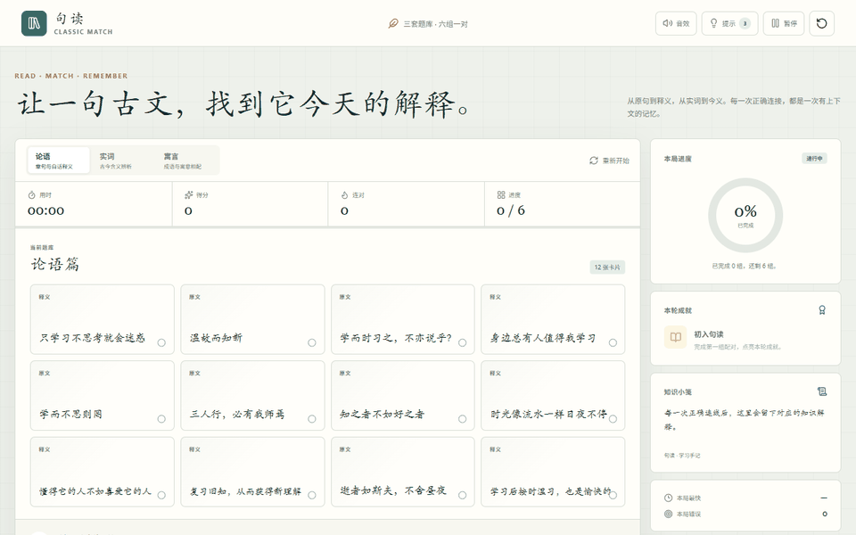
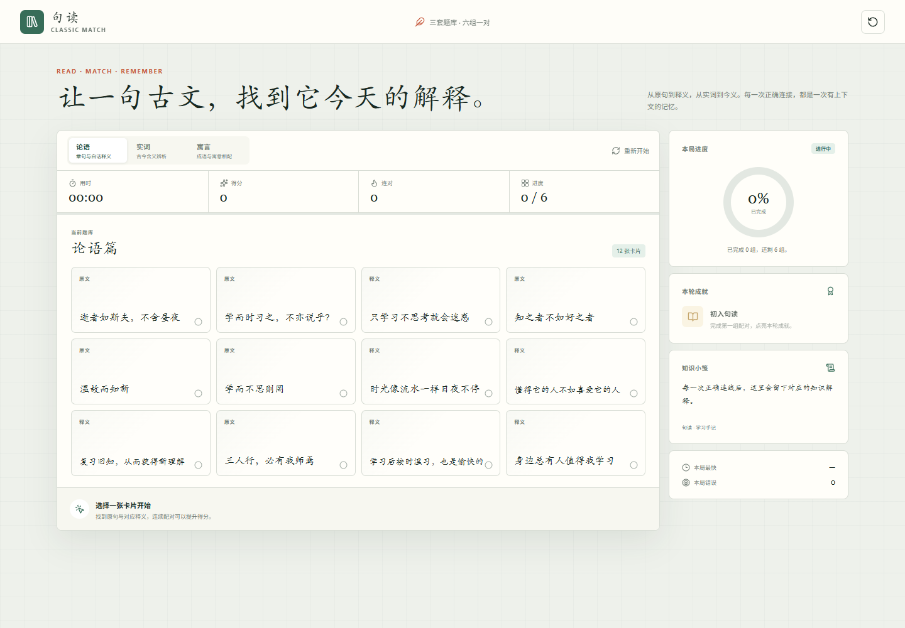
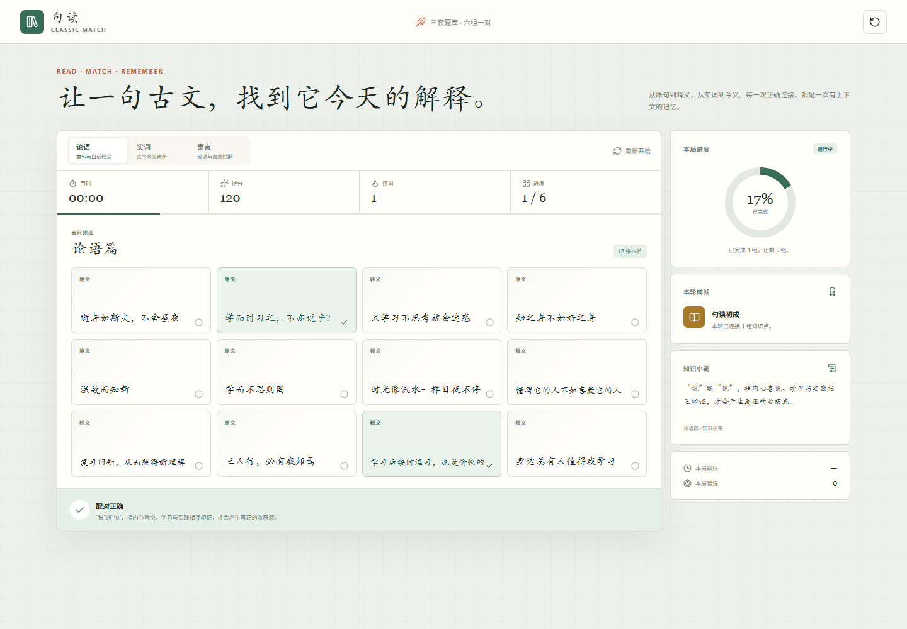
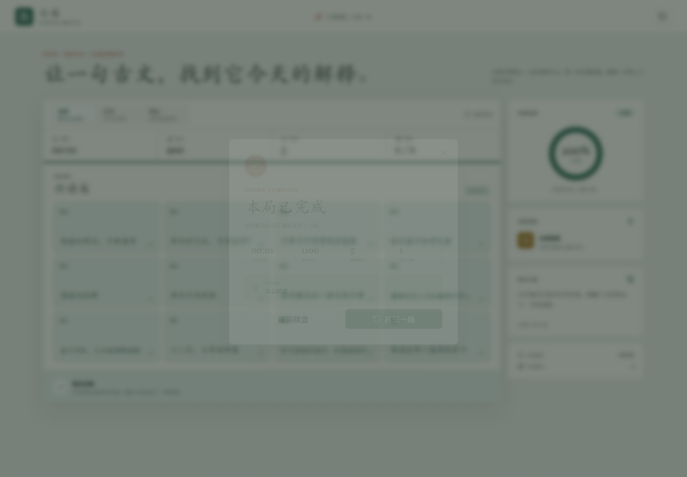
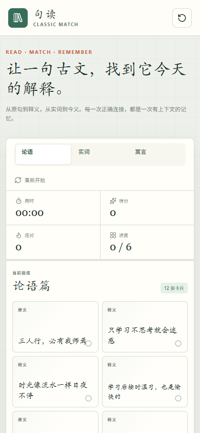
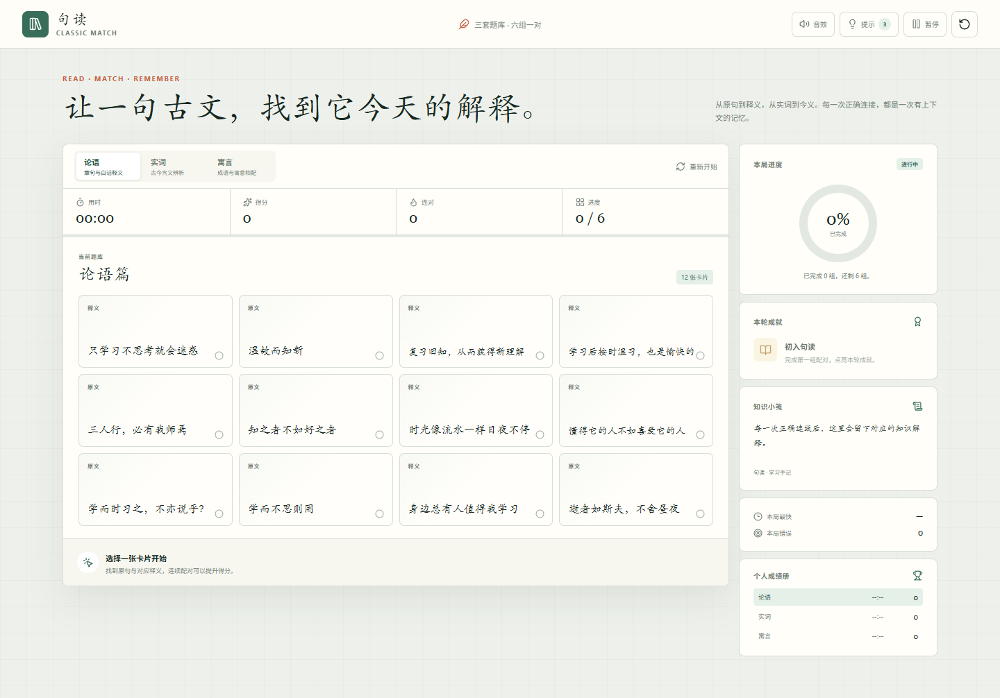
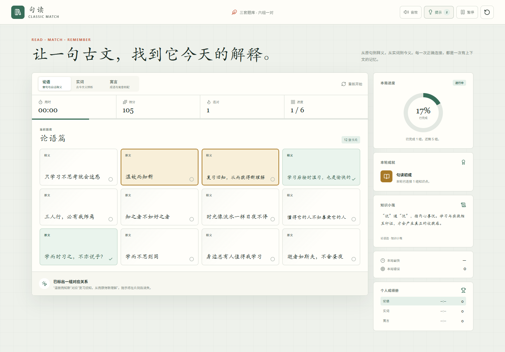
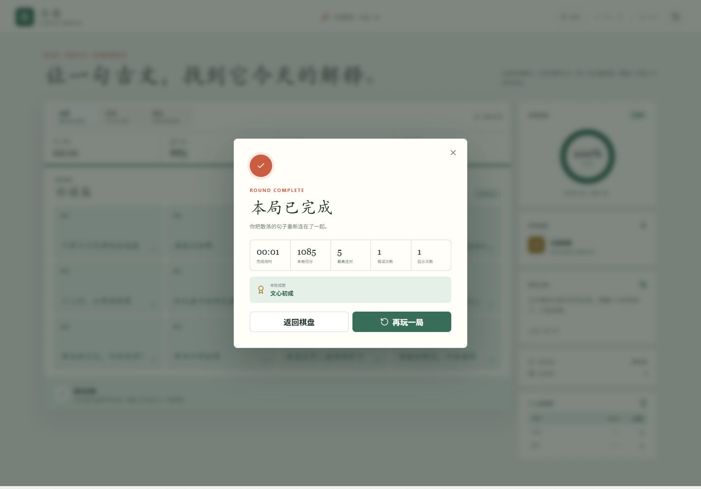
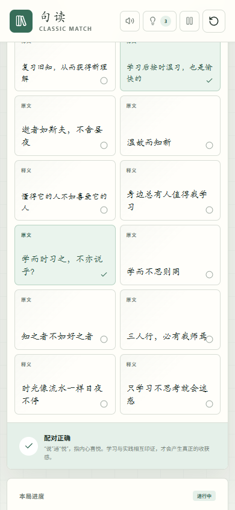

# 实验四：句读 Classic Match

面向初中生的文言文连连看，使用原生 HTML、CSS 和 JavaScript 开发。项目内置《论语》章句、文言实词和寓言成语 3 套题库。

## 运行

直接打开根目录的 `index.html` 即可运行 V2。也可以在本目录启动静态服务器：

```powershell
python -m http.server 5516
```

然后访问 <http://127.0.0.1:5516/lab4-classic-match/>。第一版访问 <http://127.0.0.1:5516/lab4-classic-match/v1/>。

## 设计材料

- [用户画像、场景故事、功能边界、交互流程与 MVP](design/mvp.md)
- [Mermaid 交互流程图](design/flow.mmd)
- [设计提示词](prompts/00-design-prompt.md)

## 两版材料

| 版本 | 代码 | 提示词 | 运行记录 |
| --- | --- | --- | --- |
| V1 核心功能版 | [`v1/index.html`](v1/index.html) | [`prompts/01-v1-prompt.md`](prompts/01-v1-prompt.md) | [`screenshots/v1/`](screenshots/v1/) |
| V2 迭代版 | [`index.html`](index.html) | [`prompts/02-v2-prompt.md`](prompts/02-v2-prompt.md) | [`screenshots/v2/`](screenshots/v2/) |

V1 实现 3 套题库、卡片配对、计时得分、进度、知识解释、成就和结算。V2 根据测试结果增加音效、每局 3 次提示、暂停继续、更具体的错误反馈和持久化成绩册。

## 演示



### V1

#### 初始棋盘



#### 正确配对



#### 本局结算



#### 移动端



### V2

#### 初始棋盘



#### 提示功能



#### 本局结算



#### 移动端配对


